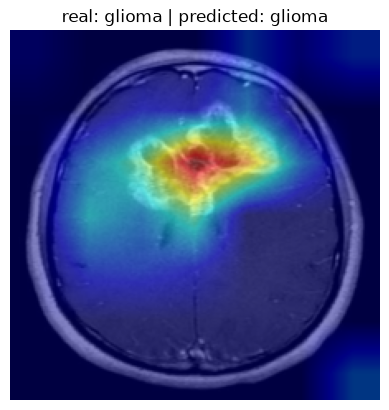
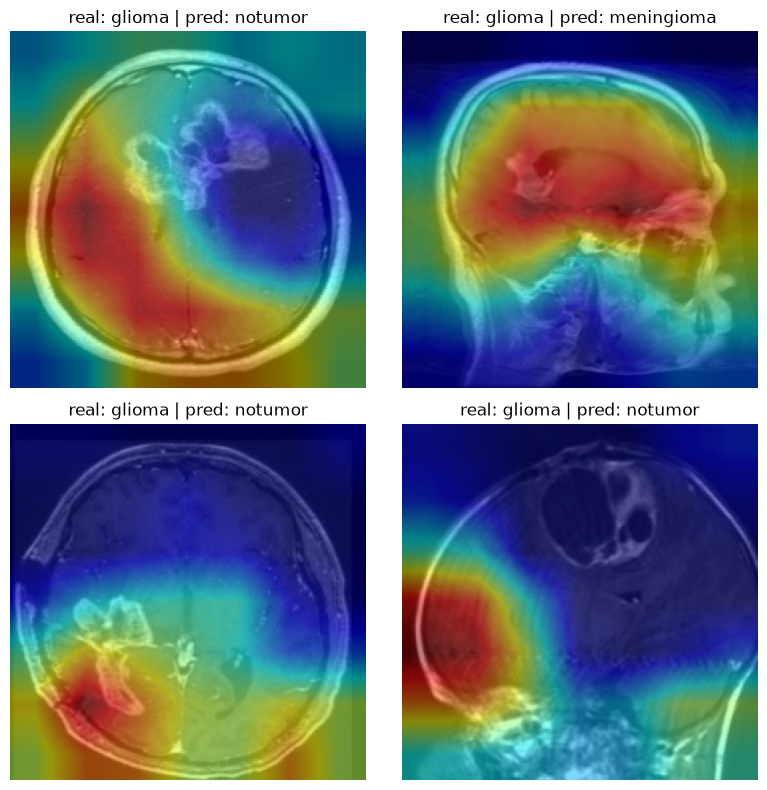

# Brain Tumor MRI Classifier (PyTorch + ResNet-18 + Grad-CAM)

An educational deep learning project that classifies brain MRI scans into four categories (**glioma**, **meningioma**, **pituitary**, and **no tumor**) using transfer learning with ResNet-18 and explains model predictions with Grad-CAM heatmaps[cite: 1, 2, 4].

> **Disclaimer:** This is a learning project, not a medical tool. It cannot be used to diagnose anyone[cite: 1].

## Results (1,600 Unseen Test Scans)
* **Frozen ResNet-18 Baseline (5 epochs):** 84.0% accuracy[cite: 8, 11]
* **Fine-Tuned ResNet-18 (4 epochs, `lr=1e-4`):** 94.3% accuracy[cite: 10, 11]
  * `notumor`: 100.0% (400/400)[cite: 11]
  * `pituitary`: 99.2% (397/400)[cite: 11]
  * `meningioma`: 98.8% (395/400)[cite: 11]
  * `glioma`: 79.2% (317/400)[cite: 11]

## Grad-CAM Visualizations



## How to Run Locally
1. Create and activate a virtual environment, then install dependencies:
   ```bash
   pip install -r requirements.txt